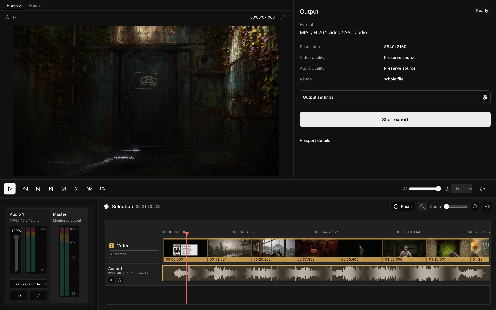

#  YAFFW

YAFFW is a video editor that runs in your browser, built around my own editing workflow. Open a local video, pick the part you want, adjust the audio, and export it. Media processing stays on your device—your video isn't uploaded to a server.

**[Try YAFFW](https://yaffw.serhii-resnyanskyi.workers.dev/)**

> **⚠️ Personal Project Disclaimer**
>
> This project is highly opinionated and was built specifically to address my personal video editing workflow needs. While it's open source and you're welcome to use or fork it, please note that feature requests, extensive customizations, or significant architectural changes may not align with the project's focused scope. Consider it a reference implementation rather than a general-purpose solution.



## Getting started

1. **Open a video.** Drop a file into the editor or use the file picker. The Media panel shows its details and tracks.
2. **Choose what to keep.** Drag the selection handles, inspect the thumbnails and audio waveforms, and preview the range. Use the Audio panel to adjust which tracks contribute to the output and how loud they are.
3. **Export and download.** In the Export panel, open Output settings to choose the format and quality, then Apply. Review the output, start the export, and use Download when it's ready.

The initial selection covers the whole video, so you can also use YAFFW to change a file's format or audio without cutting it.

## What it can do

- **Preview and select:** seek through video thumbnails and waveforms, zoom the timeline, step through frames, loop the selection, change playback speed, and open fullscreen preview.
- **Adjust audio:** include or exclude embedded audio tracks, change their volume, handle one-sided stereo recordings, and monitor individual tracks or the combined output with level meters. Included tracks are mixed into one output audio track. Preview solo, global preview volume, and mute only change what you hear while editing; track inclusion, track volume, and channel handling affect the export.
- **Choose the output:** export to MP4, MOV, MKV, WebM, or MPEG-TS with compatible video and audio codecs. Keep the source resolution or downscale, choose video and audio quality independently, set custom bitrates, or select No audio. Available combinations depend on the format and your browser's codec support.
- **Reuse settings:** save export presets in your browser, or load Last used settings. Loading a preset updates the settings draft; Apply commits it to the current edit.
- **Arrange the workbench:** resize Preview, Transport, Selection, Media, Audio, and Export panels. Hold **Alt / Option** and drag panel content to move it into a split or a shared tab group. Right-click a panel to maximize, restore, or reset the layout. Your layout is remembered locally; small screens use a stacked arrangement.

## Keyboard shortcuts

| Key | Action |
| --- | --- |
| Space or K | Play / pause |
| ← / → | Seek backward / forward one second |
| J / L | Seek backward / forward ten seconds |
| Shift + ← / → | Step backward / forward one frame |
| [ / ] | Set the selection start / end at the playhead |

Shortcuts pause while you're editing an input, using a dialog, or exporting.

## A few limitations

- **Chromium comes first.** Use a browser with WebCodecs support, such as Chrome or Edge. Individual codecs and export formats can still be unavailable in your browser.
- **One local video at a time.** Audio-only files and multi-video compositions aren't supported.
- **The current edit isn't saved across refreshes.** Your layout and export presets are remembered, but the loaded video, selection, applied output settings, and export result are not. Download the result before closing or refreshing the page.
- **Export boundaries are best effort.** A carefully placed selection doesn't guarantee exact exported start and end frames. Variable frame rates can also make frame stepping repeat or skip a displayed frame.
- **Large exports need memory.** The generated output is currently buffered in memory before download, so file size and available browser memory matter.

## Run locally

You'll need Node.js and **pnpm 10.33.0**, the version pinned in `package.json`. There are no API keys, environment variables, backend services, or FFmpeg installation to configure.

```sh
git clone https://github.com/DarkZeus/yaffw.git
cd yaffw
pnpm install --frozen-lockfile
pnpm dev
```

Open [localhost:3000](http://localhost:3000).

Useful development commands:

| Command | Purpose |
| --- | --- |
| `pnpm run check` | Check formatting and lint rules with Biome |
| `pnpm run typecheck` | Check TypeScript |
| `pnpm test` | Run the test suite |
| `pnpm run build` | Build to `dist` and check TypeScript |
| `pnpm run serve` | Preview the production build locally |

The app uses React, TypeScript, Vite, Tailwind CSS, shadcn/ui with Base UI, and Mediabunny for browser media processing.

## Acknowledgements

Thank you to the developers and contributors behind the libraries that make YAFFW possible:

- [Mediabunny](https://mediabunny.dev/) by [David P. (Vanilagy)](https://github.com/Vanilagy), for media reading, conversion, and export in the browser.
- [shadcn/ui](https://ui.shadcn.com/) by [shadcn](https://shadcn.com/), for the UI components.
- [Tailwind CSS](https://tailwindcss.com/) by [Adam Wathan](https://adamwathan.me/) and the [Tailwind CSS team and contributors](https://github.com/tailwindlabs/tailwindcss/graphs/contributors), for the styling toolkit.
- [wavesurfer.js](https://wavesurfer.xyz/) by [Ivan K. (katspaugh)](https://github.com/katspaugh), for interactive audio waveforms.
